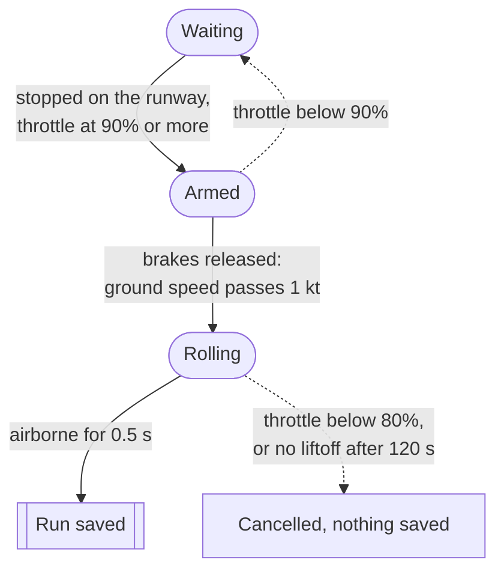

# Takeoff Logger

Records takeoff runs in Microsoft Flight Simulator (2020 and 2024) through SimConnect. Every run is saved frame by frame, plus one summary row with the ground roll, liftoff speeds and air conditions.

Two investigations use it, and each one has its own folder:

- **IA** in `IA/`: how aircraft mass affects the takeoff ground roll
- **EE** in `EE/`: how air density, changed through temperature and altitude, affects the takeoff

## Setup

Windows with 64-bit Python 3, then:

```
py -m pip install SimConnect
```

## Recording runs

Load into a flight and sit in the cockpit first, then double-click one of these. The window's title says where the runs are going.

- **Check sim connection.bat**: a live readout to test the connection. Sit still for 2 minutes: the wind max should stay at 0.0.
- **Record IA runs.bat**: records IA runs into `IA/`
- **Record EE runs.bat**: records EE runs into `EE/` and sorts each one into its series

Stop with Ctrl+C. Windows may then ask "Terminate batch job (Y/N)?". Either answer is fine, because finished runs are already saved.

The shortcuts run these commands, which also work typed into a terminal in this folder:

```
py takeoff_logger.py --check
```

```
py takeoff_logger.py
```

```
py ee_logger.py
```

Add `--out FOLDER` to save somewhere else, or `--dll PATH` to use a different SimConnect.dll, such as the one from the MSFS 2024 SDK.

### How a run is detected



1. Stop on the runway, hold the brakes and go to full throttle. The logger prints an **ARMED** line with the mass, flap angle, trim, wind, temperature, elevation and mixture: check them before you go.
2. Release the brakes. Recording starts once ground speed passes 1 kt.
3. Take off. The run is saved once the plane has stayed airborne for 0.5 s. Touching back down before that counts as a bounce: the run carries on and its `bounced` column says `yes`.

Don't pause the sim during a run. After a run is saved or cancelled, the logger waits for the next one.

## EE series

`ee_logger.py` labels every EE run using the elevation and temperature it measured:

| Series | Airport | Temperature |
| --- | --- | --- |
| `temperature` | The baseline airport (below 100 m, e.g. Ezeiza) | Any |
| `altitude` | A higher airport | The altitude-series temperature |
| `both` | The baseline airport | The altitude-series temperature, so it's the sea-level point of both series |
| `neither` | A higher airport | Anything else. The window warns you to fix it and redo the run |

The altitude-series temperature is 15 °C (±1 °C) unless you change it at the top of `ee_logger.py`:

| Setting | Default | What it does |
| --- | --- | --- |
| `BASELINE_MAX_ELEVATION_M` | 100 | Runs below this elevation count as the baseline airport |
| `ALTITUDE_SERIES_TEMP_C` | 15 | The temperature you hold fixed for the altitude series |
| `TEMP_TOLERANCE_C` | 1 | How far a run's temperature can be from that and still count |

`EE/` also gets two extra files, rebuilt after every run and whenever the script starts:

- `temperature_series.csv`: the `temperature` and `both` runs, coldest first
- `altitude_series.csv`: the `altitude` and `both` runs, lowest first

To drop a bad run, delete its row from `EE/runs_summary.csv`. It disappears from the series files the next time you start the script.

## Output

Each folder gets:

- `runs_summary.csv`: one row per run
- `run_001.csv`, `run_002.csv`, …: every simulator frame of one run, from brake release to 0.5 s after liftoff

Numbering carries on from the highest run already in the folder. If Excel puts everything in one column, use **Data → From Text/CSV**, or open the file in Google Sheets.

### runs_summary.csv

| Column | Meaning |
| --- | --- |
| `run`, `file`, `recorded_at` | Run number, its frame file, and when it was saved |
| `mass_lb`, `mass_kg` | Total aircraft mass at brake release |
| `ground_roll_m` | Start point to liftoff point, measured from the aircraft's position |
| `ground_roll_check_m` | Same distance from integrating ground speed over time, as a cross-check |
| `roll_time_s` | Time from brake release to liftoff |
| `liftoff_ias_kt`, `liftoff_tas_kt`, `liftoff_gs_kt` | Indicated airspeed, true airspeed and ground speed at liftoff |
| `liftoff_aoa_deg`, `liftoff_pitch_deg` | Angle of attack and pitch at liftoff |
| `flaps_deg`, `trim_pct` | Flap angle and elevator trim at brake release |
| `max_rpm` | Highest engine RPM during the roll |
| `temp_c`, `pressure_hpa` | Mean outside air temperature and ambient pressure during the roll |
| `air_density_kg_m3` | Air density from those two: ρ = p / (R·T), R = 287.05 J/(kg·K) |
| `max_wind_kt` | Highest wind speed during the roll |
| `bounced` | `yes` if it touched back down before lifting off for good |
| `flaps_moved` | `yes` if the flaps moved more than 1° during the roll |
| `time_source` | `sim clock`, or `pc clock` if the sim's clock didn't tick every frame |
| `elevation_m` | Ground elevation at the start point |
| `mixture_pct` | Mixture lever position at brake release |
| `series`, `series_note` | EE only: the run's series, and why when it's `neither` |

Liftoff is taken as halfway between the last frame on the ground and the first frame in the air.

`elevation_m` and `mixture_pct` were added later. A summary file started by an older version, like the one in `IA/`, keeps its original columns, so new runs still line up with the old ones.

### run_NNN.csv

One row per simulator frame.

| Column | Meaning |
| --- | --- |
| `t_s` | Seconds since brake release |
| `dist_m` | Distance from the start point |
| `on_ground` | 1 on the ground, 0 in the air |
| `gs_kt`, `ias_kt`, `tas_kt` | Ground speed, indicated airspeed and true airspeed |
| `throttle_pct`, `rpm` | Throttle lever position and engine RPM |
| `pitch_deg`, `aoa_deg` | Pitch (nose-up positive) and angle of attack |
| `flaps_index`, `flaps_deg` | Flap handle position and flap angle |
| `trim_pct` | Elevator trim, as a percentage of full travel |
| `weight_lb` | Total aircraft weight |
| `temp_c`, `pressure_inhg` | Outside air temperature and ambient pressure |
| `wind_kt` | Wind speed |
| `lat_deg`, `lon_deg` | Aircraft position |
| `abs_time_s` | The simulator's absolute time |
| `ground_alt_m` | Ground elevation under the aircraft |
| `mixture_pct` | Mixture lever position |

## Settings

The recording thresholds sit at the top of `takeoff_logger.py` and apply to both investigations:

| Setting | Default | What it does |
| --- | --- | --- |
| `ARM_THROTTLE_PCT` | 90 | Throttle, while stopped, that arms a run |
| `START_SPEED_KT` | 1.0 | Ground speed that counts as brakes released |
| `ABORT_THROTTLE_PCT` | 80 | Throttle below this during the roll cancels the run |
| `AIRBORNE_CONFIRM_S` | 0.5 | How long the plane must stay airborne to count as liftoff |
| `MAX_ROLL_S` | 120 | Gives up if there's no liftoff after this long |
| `EXPECTED_FLAPS_DEG` | 10 | Warns when arming if the flaps aren't at this angle |
